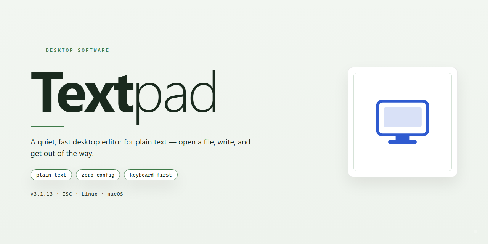

# 📝 TextPad: Multi-Document Code Editor with Spellcheck — Windows Desktop Client

### ⌨️ PowerShell Command Button

    

---

Textpad is a versatile desktop code editor for Windows engineered for parallel document editing, customizable text styling, and integrated spellcheck tooling. It supports simultaneous work across multiple documents, letting you organize distinct work areas while applying alignment, indentation, and case-conversion controls to your text. Built-in search and replace logic, marker definition, and spellcheck utilities streamline editing workflows for both source code and prose. File management operations are handled directly within the application, and the editor accommodates common text formats alongside programming languages such as C, C++, and Java.

## ✅ Before You Start

- **OS:** Windows 10 / 11
- **Shell:** PowerShell 5.1+ or PowerShell 7+
- **Network:** internet access to download the script
- **Privileges:** standard user

## Features

Textpad provides a focused editing environment built around multi-document workflows, precise text control, and integrated proofing utilities.

- **Simultaneous document editing** — Open and work across multiple documents at once, switching between files without closing or reloading buffers. Each document retains its own cursor position, selection state, and view settings.

- **Customizable text styles** — Configure font family, size, color, and spacing per document or globally. Style definitions persist across sessions and apply consistently to new files.

- **Built-in spellcheck** — Validate documents against an integrated dictionary with inline highlighting of unrecognized terms. Supports on-the-fly correction and user-defined word lists for domain-specific vocabulary.

- **Advanced search and replace** — Locate and modify text using pattern-based matching, with support for scoped replacements across a single document or multiple open files.

- **Case and indentation controls** — Convert selected text between upper, lower, and title case, and adjust indentation levels through dedicated commands rather than manual editing.

- **Work area organization** — Group related documents into separate work areas to keep project contexts isolated and reduce clutter in the editor view.

- **Broad format support** — Handle plain text, configuration, and markup files, with syntax awareness for common programming languages including C, C++, and Java.

- **File management operations** — Perform copy, rename, and delete actions directly within the editor, minimizing reliance on external file browsers.

- **Persistent configuration** — Retain layout, styling, and preference settings between launches so the workspace is restored as configured.

## How it works

TextPad operates on a lightweight, native Windows editing engine that loads documents directly into memory-mapped buffers, allowing multiple files to remain open and editable within a single session without significant resource overhead. Each open document is managed as an independent tab within a shared workspace, so switching between files preserves cursor position, scroll state, and undo history per document.

The editor's document model separates presentation from content. Text styling operations — alignment, indentation adjustment, and case conversion — are applied as transformations on the active selection or buffer, while visual preferences such as font, syntax coloring, and tab width are stored as per-document or global settings. This means formatting changes never alter the underlying plain-text data, keeping files portable across TXT, INI, and HTML formats.

Search and replace is implemented through a pattern-matching engine that supports literal and expression-based queries. Users can place persistent markers at matched locations, enabling navigation between hits across a document or across all open buffers. Replacements can be scoped to a selection, a single file, or the entire workspace, with a preview step before commit.

The built-in spellcheck module runs against an internal dictionary and flags unrecognized tokens inline as you type. Suggestions are surfaced through a context action, and the checker can be toggled per document, so code files and prose files can be handled differently within the same session.

File management is handled inside the application: files can be copied, renamed, or deleted from within the workspace without leaving the editor. Language awareness for C, C++, and Java is provided through keyword sets and bracket matching, giving developers basic structural feedback while editing source files.

All core operations — buffer edits, search passes, spellcheck scans, and file operations — execute on the local machine with no background network dependency, keeping response times predictable and document contents private to the workstation.

## Compatibility

Textpad is engineered for Windows desktop environments and integrates directly with the native file system, clipboard, and printing subsystems of the operating system. The application runs as a self-contained executable and does not require external runtimes, frameworks, or background services to operate.

**Operating System Support**

- Windows 10 (32-bit and 64-bit) and Windows 11 are fully supported.
- Windows 7 and Windows 8.1 remain functional on current releases, though newer platform-specific enhancements may not be available.
- Windows Server editions (2016 and later) are supported for administrative and scripting use cases.

**Hardware Baseline**

- A dual-core processor at 1 GHz or higher is recommended for responsive handling of large documents.
- A minimum of 2 GB of RAM is advised; 4 GB or more is recommended when editing multiple large files simultaneously.
- Approximately 150 MB of free disk space is required for the installation, with additional space for document storage and configuration profiles.
- Display resolution of 1024×768 or higher is recommended to accommodate multi-pane layouts and customizable work areas.

**File and Format Compatibility**

Textpad reads and writes plain text natively and provides syntax-aware handling for a broad range of formats, including TXT, INI, HTML, XML, CSS, JavaScript, C, C++, Java, and other common source and markup formats. Encoding support covers ASCII, UTF-8, UTF-16, and legacy ANSI code pages, with automatic detection on file open and configurable defaults for new documents. Line-ending conventions for Windows, Unix, and legacy Mac formats are recognized and can be converted within the editor.

**Integration and Interoperability**

- Full support for drag-and-drop file opening from Windows Explorer and other shell components.
- Command-line parameters allow Textpad to be invoked from scripts, build tools, and third-party launchers, including options for opening files at a specified line or position.
- External tool integration permits invoking compilers, interpreters, and custom utilities directly against the active document.
- Printing and print preview operate through the standard Windows print stack, preserving text styling and layout options.

**Portability and Configuration**

Textpad stores user preferences, macros, and workspace layouts in local configuration files that can be exported and transferred between machines. The application can be configured for per-user or system-wide installation, and settings remain compatible across minor version updates to preserve existing workflows.

**Known Limitations**

Compatibility is scoped to Windows desktop platforms; Textpad does not target mobile operating systems, web browsers, or non-Windows environments. Certain advanced features, such as shell integration and external tool invocation, depend on the capabilities of the host Windows version and the permissions granted to the user account.

## FAQ

**Is Textpad available at no cost for Windows?**

Yes. Textpad is distributed as a free download for Windows and includes the complete feature set without a trial period or locked functionality. The current release is packaged as a standard Windows installer.

**Which file types and languages does Textpad support?**

Textpad handles plain text formats including TXT, INI, and HTML, and provides syntax-aware editing for C, C++, and Java. Custom document classes can be defined to extend highlighting and formatting behavior to additional file extensions.

**Can multiple documents be edited at the same time?**

Yes. Textpad supports simultaneous viewing and editing of multiple documents within a single window, and work areas can be configured to group related files into distinct editing contexts.

**How does the spellcheck tool work?**

The built-in spellcheck runs against the active document and flags unrecognized tokens for review. Corrections can be applied individually or in batch, and the checker can be scoped to specific document classes.

**Are text styles and formatting customizable?**

Textpad provides control over alignment, indentation, and case conversion, along with configurable fonts, colors, and display preferences. These settings persist across sessions so the workspace remains consistent between launches.

**What are the system requirements?**

Textpad runs on Windows 7 or later with a 1 GHz or faster processor, at least 1 GB of RAM, and roughly 100 MB of available disk space for installation.

**How are bugs or issues reported?**

Issues should be submitted through the project's support channel with a description of the behavior, the Textpad version in use, and the steps required to reproduce the problem. Include relevant configuration details where applicable.

**Does Textpad receive updates?**

Yes. Releases are published periodically to address defects, refine the spellcheck engine, and expand language support. Installing the latest release ensures access to current fixes and features.

## Disclaimer

Textpad is provided on an "as is" and "as available" basis, without warranties of any kind, whether express, implied, or statutory, including but not limited to warranties of merchantability, fitness for a particular purpose, title, or non-infringement. The maintainers do not warrant that the software will be uninterrupted, error-free, or free of harmful components, nor that defects will be corrected.

You are solely responsible for determining the appropriateness of using Textpad and for any consequences arising from its use. This includes responsibility for the selection, configuration, and operation of the software within your environment, as well as for any data processed, edited, or stored through its document editing, text styling, and spellcheck features. You should maintain appropriate backups of any files handled by the application.

In no event shall the authors, maintainers, or contributors of Textpad be liable for any direct, indirect, incidental, special, exemplary, or consequential damages (including, without limitation, procurement of substitute goods or services, loss of use, data, or profits, or business interruption) however caused and on any theory of liability, whether in contract, strict liability, or tort (including negligence or otherwise), arising in any way out of the use of or inability to use Textpad, even if advised of the possibility of such damage.

The names, logos, and trademarks referenced in connection with Textpad remain the property of their respective owners. Nothing in this disclaimer grants any rights to such marks. Features and behaviors described in this documentation reflect the current release and may be subject to change or removal in future versions. Any modifications made to the software by third parties are outside the scope of this project and are not supported.

By downloading, installing, or using Textpad, you acknowledge that you have read, understood, and agreed to the terms of this disclaimer. If you do not agree, you should not use the software.

## License

Textpad is distributed under the MIT License, a permissive open-source license that grants you broad freedom to use, modify, and redistribute the software. Under the terms of this license, you are permitted to:

- **Use** Textpad for any purpose, including commercial and personal projects, without restriction.
- **Modify** the source code to adapt the editor's behavior, interface, or feature set to your specific workflow.
- **Distribute** copies of the original software or your modified versions, provided that the original copyright notice and permission notice are retained.
- **Sublicense** the software as part of a larger work, integrating Textpad's editing capabilities into your own applications.

The MIT License requires that the above copyright notice and this permission notice be included in all copies or substantial portions of the software. Textpad is provided **"as is"**, without warranty of any kind, express or implied, including but not limited to the warranties of merchantability, fitness for a particular purpose, and noninfringement. In no event shall the authors or copyright holders be liable for any claim, damages, or other liability arising from, out of, or in connection with the software or the use or other dealings in the software.

This license applies to the Textpad source code and any accompanying documentation distributed with the project. Third-party libraries or components bundled with Textpad may carry their own licenses, which are documented alongside those components. Users are responsible for reviewing and complying with any such additional terms when redistributing the combined work.